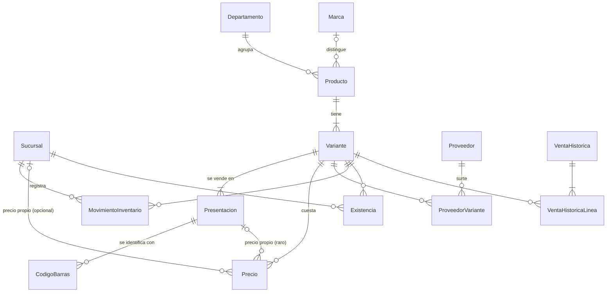

# Modelo de datos — fase 0

> Cubre solo lo que pide la fase 0 (catálogo, precios, proveedores, kardex e histórico importado). Ventas, turnos,
> usuarios, pedidos y recetas se agregan en su fase, sin cambiar lo de aquí.

## Diagrama

## Reglas generales

| Regla | Detalle |
|---|---|
| IDs | UUIDv7 (`Guid.CreateVersion7()`), generados donde nace el registro |
| Dinero | Centavos enteros (`long`). Precios al público **con IVA incluido** |
| Cantidades | Enteros en **milésimas de la unidad base** (`long`): 1 pieza = 1000, 1.5 m = 1500, 250 g = 250 |
| Fechas | UTC; se muestran en hora de Ciudad de México |
| Enumeraciones | Se guardan como texto (`"Compra"`, no `2`): la base se lee sin el código |
| Catálogo | Nunca se borra, se desactiva (`Activo = false`): el kardex y el histórico lo siguen apuntando |
| Sincronización | Las tablas del catálogo llevan `Version` y `ModificadoUtc` desde ya, para bajar cambios por versión después |
| Sucursal | Todo lo que pertenece a una sucursal lleva `SucursalId`, aunque hoy solo exista la matriz |

**Por qué milésimas:** se vende por metro y a granel. Con milésimas, 1.5 m o 0.250 kg son enteros, SQLite los suma
sin errores de redondeo (sus decimales no son exactos) y las piezas siguen siendo múltiplos de 1000. En el núcleo, un
tipo `Cantidad` hace la conversión para que nadie multiplique por 1000 a mano.

## Catálogo

**Sucursal**: `Id`, `Clave` (corta, para folios: `M`, `S2`), `Nombre`, `Activa`.

**Departamento**: `Id`, `Nombre`, `Activo`. Plano, como en eleventa.

**Marca**: `Id`, `Nombre` (único, sin importar mayúsculas ni acentos), `Activa`. Tabla propia y no texto libre:
distingue productos parecidos ("Pluma punto fino" de Bic y de Pelikan), se busca por ella y evita tener "Bic",
"BIC" y "bic" como tres marcas distintas.

**Producto** es el modelo que se ve en la búsqueda ("Pluma Bic punto fino"):

| Campo | Notas |
|---|---|
| `Nombre`, `MarcaId`, `DepartamentoId` | `MarcaId` opcional (genéricos, servicios) |
| `Tipo` | `Mercancia`, `Servicio`, `Kit`, `CobroTerceros` (recargas y pagos de servicios: solo la comisión es ingreso) |
| `ClaveSat`, `ClaveUnidadSat`, `Impuesto` | Fiscales. `Impuesto`: `Iva16`, `Iva0` o `Exento` (sin IEPS) |
| `Activo` | |

Solo `Mercancia` lleva inventario. Servicios y kits existen desde ya para que la importación los distinga; sus
componentes y recetas llegan en las fases 3 y 4.

**Variante** es lo que se cuenta y se vende ("Azul"). Un producto sin variantes tiene exactamente una.

| Campo | Notas |
|---|---|
| `ProductoId`, `Descripcion` | Texto libre ("Azul", "Carta · 75 g"). Vacía si es la única |
| `UnidadBase` | `Pieza`, `Metro`, `Kilogramo` o `Litro`. Solo `Pieza` exige cantidades enteras |
| `ManejaCaducidad` | Para los pocos productos que caducan |
| `Activa` | |

Más adelante las variantes llevarán **atributos** (Color = Azul, Tamaño = Carta) para filtrar ("todas las plumas
azules"). Se agregan como una tabla aparte sin tocar lo de aquí, y la `Descripcion` queda como respaldo.

**Presentacion**: `VarianteId`, `Nombre` ("Pieza", "Paquete 12", "Rollo 50 m"), `Factor` (en milésimas de la unidad
base), `EsBase`. Cada variante tiene una presentación base con factor de una unidad (1000).

**CodigoBarras**: `Codigo` (único en todo el catálogo), `PresentacionId`, `Origen` (`Fabrica` o `Interno`). El
código apunta a la presentación, no a la variante: escanear el código del paquete vende un paquete. Una presentación
puede tener varios códigos.

**Precio**: `VarianteId`, `PresentacionId` (casi siempre vacío), `SucursalId` (vacío = precio base),
`CantidadMinima` (1 = menudeo; 12, 50… = escalas de mayoreo), `PrecioCentavos`.

- Lo normal es un **precio por unidad base** (por pieza, por metro, por kilo). Una presentación cuesta ese precio por
  su factor: el paquete de 12 cuesta 12 piezas.
- Si una presentación tiene precio propio (es raro), se captura con `PresentacionId` y gana sobre el cálculo.
- Para cobrar se busca primero el precio de la sucursal y, si no hay, el base. Luego se usa la escala más alta que
  alcance la cantidad, contada en unidades base (un paquete de 12 cuenta como 12 piezas para el mayoreo).
- Importe de una línea = precio × cantidad, redondeado al centavo (1.5 m a $7.50 = $11.25).
- Cada cambio de precio se copia a `PrecioHistorial` (variante, presentación, sucursal, escala, precio anterior y
  nuevo, fecha). Sirve para el análisis y para la bitácora de la fase 1.

**Proveedor**: `Nombre`, `Telefono`, `Rfc`, `Notas`, `Activo`.

**ProveedorVariante**: `ProveedorId`, `VarianteId`, `CodigoProveedor`, `UltimoCostoCentavos` (por unidad base),
`UltimaCompraUtc`.

## Kardex

**MovimientoInventario**: solo se agregan filas; nunca se editan ni se borran. Un error se corrige con otro
movimiento.

| Campo | Notas |
|---|---|
| `SucursalId`, `VarianteId`, `FechaUtc` | |
| `Tipo` | `InventarioInicial`, `Venta`, `Devolucion`, `Compra`, `Ajuste`, `Merma`, `TraspasoSalida`, `TraspasoEntrada`, `ConsumoServicio`, `AperturaPaquete`, `Conteo` |
| `Cantidad` | Con signo, en milésimas de la unidad base: + entra, − sale |
| `CostoCentavos` | **Costo total** del movimiento, con signo (no unitario) |
| `DocumentoTipo`, `DocumentoId` | De dónde salió (venta, compra, conteo…). Vacíos en fase 0 salvo la importación |
| `Motivo` | Obligatorio en ajustes y mermas |

Por qué costo total y no unitario: el costo de una pieza que viene en una caja de 144 por $100 es 69.44 centavos, y
con centavos enteros se perdería. Con el total, el valor del inventario es exacto:

- **Existencia** = Σ `Cantidad`
- **Valor** = Σ `CostoCentavos`
- **Costo promedio** = valor ÷ existencia (se calcula, no se guarda)
- Una **entrada** (compra) lleva su costo real. Una **salida** lleva `costo promedio × cantidad`, redondeado al
  centavo.
- Con existencia en cero o negativa (se permite vender sin existencia), la salida usa el último costo conocido.

El costo promedio es **por sucursal**: un traspaso sale de la matriz a su promedio y entra a la sucursal 2 con ese
mismo costo.

**Existencia** (`SucursalId`, `VarianteId`, `Cantidad`, `CostoCentavos`): copia de las sumas de arriba para que la
caja no tenga que sumar todo el kardex en cada consulta. Se actualiza en la misma transacción que el movimiento y se
puede reconstruir desde el kardex en cualquier momento; una prueba verifica que siempre coincidan.

El **disponible** (existencia menos lo apartado en pedidos) llega con los pedidos, en la fase 4.

## Histórico importado

El historial de eleventa no tiene folios por caja, turnos ni cortes, así que no se mezcla con las ventas del POS.
Solo alimenta el análisis ABC, la temporada y el sugerido de compra.

**VentaHistorica**: `SucursalId`, `FechaUtc`, `FolioOrigen`, `TotalCentavos`, `Cancelada`.

**VentaHistoricaLinea**: `VentaHistoricaId`, `VarianteId`, `Cantidad`, `PrecioCentavos`, `CostoCentavos` (como lo
guardó eleventa).

**MapeoImportacion**: `Origen` (`eleventa`), `Entidad`, `IdOrigen`, `IdNuevo`. Permite repetir la importación sin
duplicar y rastrear de dónde salió cada registro. En fase 0 lo usa el generador de datos ficticios, para probar ese
camino desde el principio.

## Cómo queda en el código

- **`PapeleriaPos.Nucleo`**: las entidades como clases simples, sin atributos de EF, y las reglas (`Cantidad`,
  precio que aplica, costo de una salida, existencia). No conoce la base de datos.
- **`PapeleriaPos.Datos`**: el `DbContext`, la configuración de cada tabla (Fluent API), las conversiones (enums a
  texto) y las migraciones.
- **`PapeleriaPos.Herramientas`** (nuevo, consola):
  - `generar-ficticios`: crea una base con productos de papelería inventados y una semilla fija (siempre salen
    iguales). Unas 200 familias para llegar a ~3,000 variantes, con marcas, presentaciones, productos por metro y a
    granel, mayoreo, proveedores y un año de ventas con el pico de regreso a clases.
  - `diagnostico`: el Excel, primero sobre la base ficticia.
  - `importar-eleventa`: al final de la fase.
- **`PapeleriaPos.Pruebas`**: reglas del núcleo sin base de datos, y pruebas de la capa de datos contra SQLite en
  memoria.

## Decisiones de la revisión

| Pregunta | Respuesta | Efecto en el modelo |
|---|---|---|
| ¿Se vende con fracciones? | Sí, por metro y a granel | Cantidades en milésimas; unidades `Metro`, `Kilogramo`, `Litro` |
| ¿El paquete tiene precio propio? | Es raro | Precio por unidad base; precio de presentación solo como excepción |
| ¿Costo promedio por sucursal? | Sí | Se calcula con los movimientos de cada sucursal |
| ¿Variantes con atributos? | Texto libre ahora; con atributos al final | Tabla de atributos después, sin cambiar lo de aquí |
| ¿IEPS? | No | `Impuesto`: `Iva16`, `Iva0`, `Exento` |
| Marca | Sirve para diferenciar | Tabla `Marca` propia |
